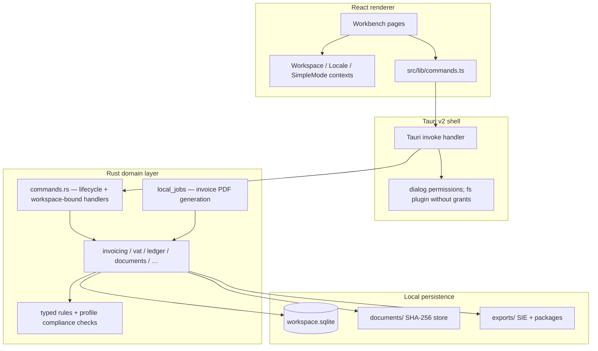

# Architecture Codemap

High-level system overview for the ÖppenBokföring desktop application.
This existing document is the architecture node; there is no parallel root
`architecture.md`. Its adopted contracts and source-based corrections await review.

## System diagram

## Architectural invariants

| Invariant | Enforcement |
|-----------|-------------|
| Renderer never writes SQLite | ADR-0003; all mutations via `invoke()` |
| Accounting policy stays in Rust | Versioned rules plus domain posting/approval guards; compliance is a profile evaluator, not a universal posting engine |
| Domain-specific replay protection | Keyed operations use `local_jobs`; draft/profile/settings writes are not universally keyed |
| Workspace scoping | Workspace-bound commands clone the current `AppState` context; lifecycle and integration-status commands are exceptions |
| Local-first evidence | Content-addressed `documents/` per workspace |
| Prepare-only tax | ADR-0004; no filing or payment initiation |

## Request flow

1. A user action in a React page (`src/pages/*`) calls a typed wrapper in `src/lib/commands.ts`.
2. The wrapper calls Tauri `invoke<T>()`.
3. Tauri routes to a registered `#[tauri::command]` in `src-tauri/src/commands.rs`.
4. Workspace-bound commands obtain a `WorkspaceContext` and call domain modules. Lifecycle commands also orchestrate SQL and filesystem work directly.
5. Domain modules share SQLx persistence, evaluate applicable rules, and may store replay results or enqueue invoice-PDF work in `local_jobs`.
6. Success returns `{ data: T }`; failure rejects with `AppError` (structured, redacted storage errors).

## Boundaries and dependency shape

The renderer owns interaction and presentation; the Rust crate owns persistence,
posting, evidence, and artifact generation under `rust-command-boundary`.
The two cross only through typed commands, apart from native path-selection dialogs.

The backend is one crate with shared tables, not isolated repositories. Its
sibling services call each other and query shared tables directly. Do not infer a
DAG or exclusive ledger-write ownership; actual sibling calls and cycles are
recorded once in `rust-backend`. `renderer` owns the frontend module boundary. The `desktop` feature gates the command adapter and Tauri runtime,
while domain code can be tested without it.

Observed limitation (unconfirmed as a product decision): the workspace mutex
protects context selection only. An operation retains its cloned context after
close/switch; there is no operation-wide workspace lock or cancellation.

## Major subsystems

| Subsystem | Rust module | Primary UI |
|-----------|-------------|------------|
| Workspace lifecycle | `workspace`, `backup`, `recent` | `WorkspacePickerPage`, `SettingsPage` |
| Profiles & compliance | `profiles`, `compliance`, `rules` | `OnboardingPage`, `DashboardPage` |
| Tax-task projection | `tax_tasks` | `DashboardPage` |
| Invoicing & ledger | `invoicing`, `ledger`, `counterparties` | `InvoicesPage`, `LedgerPage` |
| Documents & imports | `documents`, `imports`, `reconciliation`, `expenses` | `DocumentsPage` |
| VAT & cash | `vat`, `cashflow` | `VatPage`, `DashboardPage` |
| Year-end | `year_end` | `YearEndPage` |
| Export | `sie`, `accountant_package` | `SettingsPage` |
| Guided UX (M8) | `settings` | `DashboardPage`, `GuidedTour`, `SimpleModeContext` |
| Background jobs | `jobs` | Invoice PDF status / reveal |

## Error and security model

- **Client errors:** `AppError` with `code`, `message`, optional `details[]`.
- **SQL errors:** Redacted public message; `unique_violation` flag preserved internally for idempotency replay.
- **Path operations:** `paths.rs`, `workspace::safe_join_under`, canonical containment checks, and `workspace_open` document-layout validation. These are distinct checks, not a universal path-safety wrapper.
- **Permissions:** Main-window capability grants `core:default` and `dialog:default` only. The fs plugin is installed but has no renderer grants; CSP limits resources to self/assets/data and connections to IPC. Requirements and observed gaps live in `security-privacy`.

## Testing layers

| Layer | Location | Runner |
|-------|----------|--------|
| Golden scenarios | `fixtures/golden-scenarios/*.json` | `npm run test:golden` |
| UI scenario | `fixtures/ui-scenarios/guided-ux-onboarding-checklist.json` | `npm run test:m8` |
| Rust integration | `src-tauri/tests/*.rs` | `npm run test:rust` |
| Frontend unit/component | `src/**/*.test.ts(x)` | `npm test` |
| Public CI gate | fixtures, Rust, frontend, build, bindings | `npm run ci:public` |

## Related docs

- [README.md](./README.md) — codemap index and current scope
- [MODULES.md](./MODULES.md) — legacy module inventory (input only; graph nodes own current boundaries)
- [FILES.md](./FILES.md) — directory map
- [`docs/adr/`](../adr/) — binding architecture decisions
- [`docs/schema.md`](../schema.md) — SQLite tables and migrations
- [`CONTRIBUTING.md`](../../CONTRIBUTING.md) — public contributor workflow
